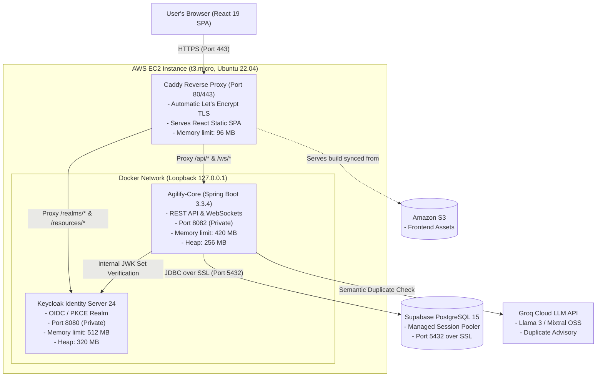
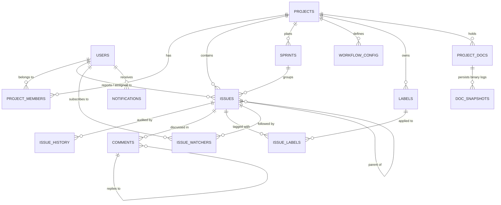
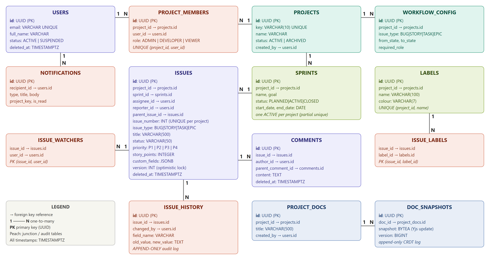
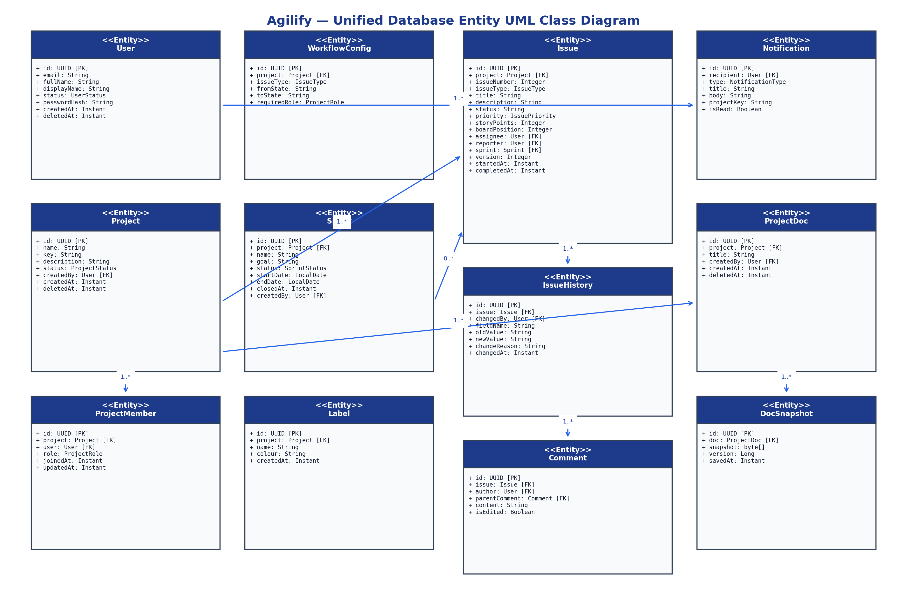
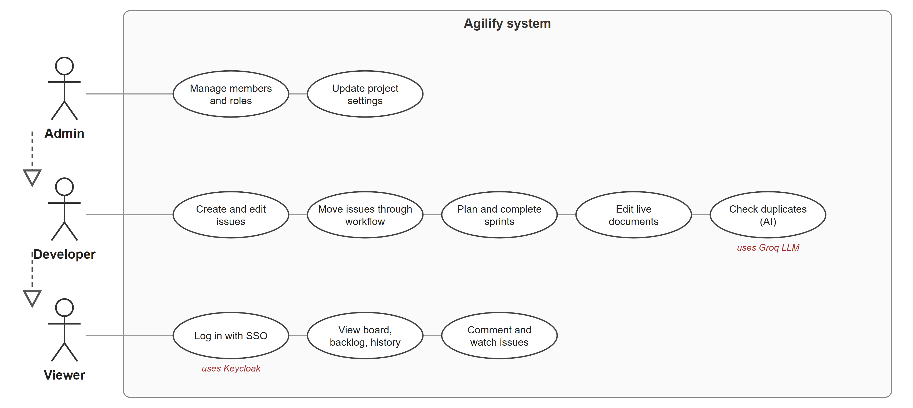

# Agilify: Database Management Systems (DBMS) Semester Project

**An Enterprise-Grade Agile Project Management Platform with Relational Integrity, Real-Time Collaborative CRDT Documents, and Semantic Duplicate Detection**

---

## Team Member Details

| Roll Number | Name | Department / School |
| :--- | :--- | :--- |
| **CB.SC.U4AIE24023** | **KIRUTHIKPRANAV** | Amrita School of Artificial Intelligence |
| **CB.SC.U4AIE24042** | **RAMKUMAR K R** | Amrita School of Artificial Intelligence |
| **CB.SC.U4AIE24050** | **DHEERAJ** | Amrita School of Artificial Intelligence |
| **CB.SC.U4AIE24060** | **VIKRAMENDRAA** | Amrita School of Artificial Intelligence |

- **Institution:** Amrita Vishwa Vidyapeetham, Coimbatore Campus
- **Degree:** B.Tech in Computer Science and Engineering (Artificial Intelligence)
- **Course Code & Title:** 22AIE303: Database Management Systems
- **Repositories:** 
  - Backend: [`im-rk/Agilify-Backend`](https://github.com/im-rk/Agilify-Backend)
  - Frontend: [`im-rk/Agilify-Frontend`](https://github.com/im-rk/Agilify-Frontend)
- **Live Cloud Deployment:** [https://35-73-249-109.sslip.io](https://35-73-249-109.sslip.io) (AWS EC2 + Supabase Managed PostgreSQL + Caddy HTTPS)

---

## Table of Contents

1. [Project Overview, Introduction, and Problem Statement](#1-project-overview-introduction-and-problem-statement)
2. [System Requirements and Architecture](#2-system-requirements-and-architecture)
3. [ER Diagram and UML Diagram](#3-er-diagram-and-uml-diagram)
4. [Relational Schema Mapping](#4-relational-schema-mapping)
5. [Normalization and Functional Dependencies](#5-normalization-and-functional-dependencies)
6. [Methodology and Database Design](#6-methodology-and-database-design)
7. [Advanced SQL Queries and Their Purpose](#7-advanced-sql-queries-and-their-purpose)
8. [Installation, Setup, and Execution Instructions](#8-installation-setup-and-execution-instructions)
9. [Demonstration Instructions (Reproducing Database State)](#9-demonstration-instructions-reproducing-database-state)
10. [Verification Queries & Operational Health](#10-verification-queries--operational-health)

---

## 1. Project Overview, Introduction, and Problem Statement

### 1.1 Executive Overview
**Agilify** is an enterprise-grade Agile project management platform engineered to deliver the comprehensive capabilities of commercial issue trackers (such as Atlassian Jira) while grounding all business logic, concurrency control, and auditability in relational database engineering. The platform manages complex software lifecycles across projects, sequential issue keys, state-machine workflows, Kanban boards, sprint iterations, hierarchical threaded discussions, and user notification fan-outs.

Beyond conventional issue tracking, Agilify incorporates two advanced capabilities:
1. **Real-Time Collaborative Documents:** A zero-locking, concurrent multi-user rich text specification editor utilizing Conflict-free Replicated Data Types (CRDT via Yjs) with binary delta relay over WebSockets and append-only database persistence.
2. **AI-Assisted Duplicate Detection:** An advisory semantic analysis engine powered by Groq's low-latency Large Language Model API that checks incoming bug titles and descriptions against the active backlog to flag redundant submissions before they enter the database.

### 1.2 Problem Statement
Commercial issue-tracking platforms frequently suffer from structural engineering flaws:
- **Hidden & Brittle Database Invariants:** Business rules (such as permitted workflow transitions, single-active sprint constraints, and sequential issue numbering) are frequently enforced solely in application code. Under heavy concurrent load, this results in race conditions, duplicate issue keys, illegal status jumps, and corrupted audit logs.
- **Redundant Issue Filing:** In large software teams, different engineers submit identical bugs described in disparate vocabulary (e.g., *"Cannot connect on mobile network"* vs. *"OAuth callback timeout over TLS"*). Standard lexical keyword matching fails to detect semantic equivalence, leading to backlog bloat.
- **Siloed Technical Documentation:** Architectural specifications are disconnected from issue trackers, requiring third-party tools with rigid document-locking mechanisms that prevent multi-engineer real-time collaboration.
- **Inflexible Authentication:** Custom authentication implementations store vulnerability-prone password hashes in application databases, lacking standardized Single Sign-On (SSO) and fine-grained per-project Role-Based Access Control (RBAC).

### 1.3 Project Objectives
The engineering objectives of Agilify are defined as:
- **Database-First Integrity:** Enforce data constraints at the storage layer via PostgreSQL `CHECK` constraints, partial unique indexes, composite keys, and PL/pgSQL triggers.
- **Dynamic Workflow State Machine:** Store permitted lifecycle transitions (`workflow_config`) directly in the database, evaluating transitions declaratively on every status modification.
- **Zero-Password Authentication & Per-Project RBAC:** Delegate identity entirely to Keycloak (OpenID Connect with PKCE) and enforce a three-tier permission model (`ADMIN`, `DEVELOPER`, `VIEWER`) across all REST and WebSocket operations.
- **Pessimistic & Optimistic Concurrency:** Protect sequential issue keys via pessimistic row-level database locks (`SELECT ... FOR UPDATE`) and prevent concurrent update clobbering via JPA entity versioning (`@Version`).
- **Conflict-Free Real-Time Collaboration:** Synchronize shared project documentation with Yjs CRDT over WebSockets, persisting raw binary deltas in PostgreSQL (`BYTEA`).
- **Cloud-Native Deployment:** Host the complete stack on the AWS free tier utilizing Docker Compose, automatic Let's Encrypt TLS via Caddy, Supabase Managed PostgreSQL, and a zero-secret GitHub Actions CI/CD pipeline using AWS OIDC federation.

---

## 2. System Requirements and Architecture

### 2.1 System Requirements

#### Development & Local Execution Requirements
- **Operating System:** Linux (Ubuntu 22.04+), macOS, or Windows 10/11 with WSL2 / PowerShell
- **Java Development Kit (JDK):** OpenJDK 17 or Eclipse Temurin 17+
- **Build Tool:** Apache Maven 3.9+ (or included `./mvnw` wrapper)
- **Node.js Runtime:** Node.js 20 LTS (v20.x or higher) with `npm` 10+
- **Containerization:** Docker Engine 24.0+ and Docker Compose v2.20+
- **Database:** PostgreSQL 15+ (with `pgcrypto` / `uuid-ossp` and `pgvector` extensions)
- **Identity Provider:** Keycloak 24.0+

#### Production Cloud Infrastructure (AWS Free Tier)
- **Compute Instance:** AWS EC2 `t3.micro` (1 vCPU, 1 GB Physical RAM, 20 GB gp3 SSD, Ubuntu 22.04 LTS)
- **Virtual Memory:** 2 GB Swap File allocated via instance user-data to prevent Out-Of-Memory (OOM) JVM termination
- **Database Engine:** Supabase Managed PostgreSQL 15 (AWS ap-northeast-1 / Tokyo region, connected via Session Pooler port 5432 over SSL)
- **Edge Proxy:** Caddy 2 (Alpine) with automatic Let's Encrypt HTTPS termination and dynamic DNS (`sslip.io`)
- **Container Registry:** Amazon Elastic Container Registry (Amazon ECR)
- **Storage:** Amazon Simple Storage Service (Amazon S3) for compiled React production bundles
- **Secrets Management:** AWS Systems Manager (SSM) Parameter Store (`SecureString` KMS encryption)
- **CI/CD Pipeline:** GitHub Actions with OpenID Connect (OIDC) AWS IAM role assumption

### 2.2 System Architecture



### 2.3 Network & Security Perimeter
- **Single Public Origin:** All web traffic enters via port 443 over HTTPS. The browser communicates with a single origin (`https://35-73-249-109.sslip.io`), eliminating Cross-Origin Resource Sharing (CORS) preflight friction and mixed-content blocking.
- **Loopback Isolation:** The Spring Boot API (port 8082) and Keycloak (port 8080) bind strictly to `127.0.0.1`. Neither backend is reachable from the open internet; only Caddy can reverse-proxy requests to them.
- **Zero Inbound Port 22 (SSH):** The EC2 security group permits inbound TCP on ports 80 and 443 only. All cloud maintenance is executed passwordlessly through AWS Systems Manager (SSM) Session Manager.

---

## 3. ER Diagram and UML Diagram

### 3.1 Entity-Relationship (ER) Diagram
Agilify's logical data model comprises **14 core relational application tables** designed in full Boyce-Codd Normal Form (BCNF) and Fourth Normal Form (4NF).



> **Detailed 14-Table Full ER Diagram:**  
> 

### 3.2 Unified JPA Domain Entity UML Class Diagram
The application layer models the database entities using Spring Data JPA and Hibernate ORM:



### 3.3 System UML Use-Case Diagram
Illustrating the boundaries and interactions between actors (`Admin`, `Developer`, `Viewer`, `System`) and functional subsystems:



---

## 4. Relational Schema Mapping

The database schema maps each conceptual entity into a relational structure with explicit primary keys (**<u>underlined</u>**), foreign keys (*), candidate keys, and referential constraints:

1. **`users`** (<u>id</u>, email, full_name, display_name, avatar_url, status, password_hash, created_at, updated_at, deleted_at)  
   - *Candidate Key:* `email` (where `deleted_at IS NULL`)  
   - *Constraints:* `status IN ('ACTIVE', 'SUSPENDED')`

2. **`projects`** (<u>id</u>, name, key, description, icon_url, status, created_by*, created_at, updated_at, deleted_at)  
   - *Foreign Key:* `created_by` &rarr; `users(id)`  
   - *Candidate Key:* `key` (where `deleted_at IS NULL`)  
   - *Constraints:* `key ~ '^[A-Z]{2,10}$'`, `status IN ('ACTIVE', 'ARCHIVED')`

3. **`project_members`** (<u>id</u>, project_id*, user_id*, role, joined_at, updated_at)  
   - *Foreign Keys:* `project_id` &rarr; `projects(id)` ON DELETE CASCADE, `user_id` &rarr; `users(id)` ON DELETE CASCADE  
   - *Candidate Key:* `(project_id, user_id)`  
   - *Constraints:* `role IN ('ADMIN', 'DEVELOPER', 'VIEWER')`

4. **`workflow_config`** (<u>id</u>, project_id*, issue_type, from_state, to_state, required_role)  
   - *Foreign Key:* `project_id` &rarr; `projects(id)` ON DELETE CASCADE  
   - *Candidate Key:* `(project_id, issue_type, from_state, to_state)`  
   - *Constraints:* `issue_type IN ('BUG', 'STORY', 'TASK', 'EPIC')`

5. **`sprints`** (<u>id</u>, project_id*, name, goal, status, start_date, end_date, closed_at, created_by*, created_at, updated_at)  
   - *Foreign Keys:* `project_id` &rarr; `projects(id)` ON DELETE CASCADE, `created_by` &rarr; `users(id)`  
   - *Constraints:* `status IN ('PLANNED', 'ACTIVE', 'COMPLETED')`, `end_date >= start_date`  
   - *Partial Unique Constraint:* Only **one** sprint with `status = 'ACTIVE'` per `project_id`

6. **`issues`** (<u>id</u>, project_id*, issue_number, issue_type, title, description, status, priority, story_points, board_position, assignee_id*, reporter_id*, parent_issue_id*, sprint_id*, due_date, custom_fields, version, started_at, completed_at, created_at, updated_at, deleted_at)  
   - *Foreign Keys:* `project_id` &rarr; `projects(id)`, `assignee_id` &rarr; `users(id)`, `reporter_id` &rarr; `users(id)`, `parent_issue_id` &rarr; `issues(id)`, `sprint_id` &rarr; `sprints(id)`  
   - *Candidate Key:* `(project_id, issue_number)`  
   - *Constraints:* `priority IN ('P1_CRITICAL', 'P2_HIGH', 'P3_MEDIUM', 'P4_LOW')`, `story_points >= 0`, `version >= 0`

7. **`issue_history`** (<u>id</u>, issue_id*, changed_by*, field_name, old_value, new_value, change_reason, changed_at)  
   - *Foreign Keys:* `issue_id` &rarr; `issues(id)` ON DELETE CASCADE, `changed_by` &rarr; `users(id)`  
   - *Characteristic:* Append-only immutable audit trail

8. **`labels`** (<u>id</u>, project_id*, name, colour, created_at)  
   - *Foreign Key:* `project_id` &rarr; `projects(id)` ON DELETE CASCADE  
   - *Candidate Key:* `(project_id, name)`

9. **`issue_labels`** (<u>issue_id*</u>, <u>label_id*</u>, added_at)  
   - *Composite Primary Key:* `(issue_id, label_id)`  
   - *Foreign Keys:* `issue_id` &rarr; `issues(id)` ON DELETE CASCADE, `label_id` &rarr; `labels(id)` ON DELETE CASCADE

10. **`issue_watchers`** (<u>issue_id*</u>, <u>user_id*</u>, added_at)  
    - *Composite Primary Key:* `(issue_id, user_id)`  
    - *Foreign Keys:* `issue_id` &rarr; `issues(id)` ON DELETE CASCADE, `user_id` &rarr; `users(id)` ON DELETE CASCADE

11. **`comments`** (<u>id</u>, issue_id*, author_id*, parent_comment_id*, content, is_edited, created_at, updated_at, deleted_at)  
    - *Foreign Keys:* `issue_id` &rarr; `issues(id)` ON DELETE CASCADE, `author_id` &rarr; `users(id)`, `parent_comment_id` &rarr; `comments(id)`  
    - *Constraints:* `length(trim(content)) > 0`

12. **`notifications`** (<u>id</u>, recipient_id*, type, title, body, referenced_type, referenced_id, project_key, is_read, created_at)  
    - *Foreign Key:* `recipient_id` &rarr; `users(id)` ON DELETE CASCADE

13. **`project_docs`** (<u>id</u>, project_id*, title, created_by*, created_at, updated_at, deleted_at)  
    - *Foreign Keys:* `project_id` &rarr; `projects(id)` ON DELETE CASCADE, `created_by` &rarr; `users(id)`

14. **`doc_snapshots`** (<u>id</u>, doc_id*, snapshot, version, saved_at)  
    - *Foreign Key:* `doc_id` &rarr; `project_docs(id)` ON DELETE CASCADE  
    - *Candidate Key:* `(doc_id, version)`  
    - *Data Type:* `snapshot BYTEA` (raw Yjs binary CRDT delta vector)

---

## 5. Normalization and Functional Dependencies

The Agilify database schema was rigorously engineered to eliminate update, insertion, and deletion anomalies through formal normalization.

### 5.1 Minimal Cover of Functional Dependencies (FDs)
- **`users`:**  
  $FD_1: id \rightarrow \{email, full\_name, display\_name, avatar\_url, status, password\_hash, created\_at, updated\_at\}$  
  $FD_2: email \rightarrow \{id, full\_name, ...\}$ (conditioned on $deleted\_at\text{ IS NULL}$)
- **`projects`:**  
  $FD_1: id \rightarrow \{name, key, description, icon\_url, status, created\_by, created\_at, updated\_at\}$  
  $FD_2: key \rightarrow \{id, name, ...\}$ (conditioned on $deleted\_at\text{ IS NULL}$)
- **`project_members`:**  
  $FD_1: id \rightarrow \{project\_id, user\_id, role, joined\_at, updated\_at\}$  
  $FD_2: \{project\_id, user\_id\} \rightarrow \{id, role, joined\_at, updated\_at\}$
- **`workflow_config`:**  
  $FD_1: id \rightarrow \{project\_id, issue\_type, from\_state, to\_state, required\_role\}$  
  $FD_2: \{project\_id, issue\_type, from\_state, to\_state\} \rightarrow \{id, required\_role\}$
- **`sprints`:**  
  $FD_1: id \rightarrow \{project\_id, name, goal, status, start\_date, end\_date, closed\_at, created\_by, created\_at, updated\_at\}$
- **`issues`:**  
  $FD_1: id \rightarrow \{project\_id, issue\_number, issue\_type, title, description, status, priority, story\_points, board\_position, assignee\_id, reporter\_id, parent\_issue\_id, sprint\_id, due\_date, custom\_fields, version, started\_at, completed\_at, created\_at, updated\_at\}$  
  $FD_2: \{project\_id, issue\_number\} \rightarrow \{id, issue\_type, title, ...\}$
- **`comments`:**  
  $FD_1: id \rightarrow \{issue\_id, author\_id, parent\_comment\_id, content, is\_edited, created\_at, updated\_at, deleted\_at\}$
- **`labels`:**  
  $FD_1: id \rightarrow \{project\_id, name, colour, created\_at\}$  
  $FD_2: \{project\_id, name\} \rightarrow \{id, colour, created\_at\}$
- **`doc_snapshots`:**  
  $FD_1: id \rightarrow \{doc\_id, snapshot, version, saved\_at\}$  
  $FD_2: \{doc\_id, version\} \rightarrow \{id, snapshot, saved\_at\}$

### 5.2 Step-by-Step Normalization Analysis

| Normal Form | Formal Definition & Schema Proof |
| :--- | :--- |
| **First Normal Form (1NF)** | **Atomic Attributes:** Every column stores strictly scalar, atomic values. Repeating groups (e.g., an issue having multiple labels or multiple watchers) are never stored as comma-separated strings or arrays; they are decomposed into separate associative junction entities (`issue_labels` and `issue_watchers`). |
| **Second Normal Form (2NF)** | **No Partial Functional Dependencies:** All non-prime attributes depend on the *entire* candidate key. In `project_members`, the attribute `role` depends on the full composite key `{project_id, user_id}`, as a user's role is unique per project. In `workflow_config`, `required_role` depends on `{project_id, issue_type, from_state, to_state}`. |
| **Third Normal Form (3NF)** | **No Transitive Dependencies:** No non-prime attribute determines another non-prime attribute ($X \rightarrow Y \rightarrow Z$). User details (`full_name`, `email`) are never replicated in `issues` or `comments`; only the foreign keys `assignee_id` and `author_id` are stored. Project names are not duplicated in issues or sprints. |
| **Boyce-Codd Normal Form (BCNF)** | **Strict Determinant Superkeys:** For every non-trivial functional dependency $X \rightarrow Y$, the determinant $X$ is a superkey. There are no overlapping candidate keys with non-prime cross-dependencies in any table. |
| **Fourth Normal Form (4NF)** | **Elimination of Multi-Valued Dependencies (MVDs):** An issue can have multiple independent labels ($issue \twoheadrightarrow label$) and multiple independent watchers ($issue \twoheadrightarrow user$). Storing both in a single table would create Cartesian product redundancy. Agilify isolates these into two separate 4NF relations (`issue_labels` and `issue_watchers`). |

---

## 6. Methodology and Database Design

### 6.1 Database Engineering Principles
1. **Defense-in-Depth:** Application-layer checks are always backed by database constraints. For example, `SprintService` validates that only one sprint is active, but the PostgreSQL partial unique index `idx_sprints_one_active_per_project` guarantees this invariant even if concurrent threads bypass the service layer.
2. **Pessimistic Concurrency for Sequential Issue Keys:** In Agile trackers, issues require human-readable sequential keys (`FOOD-1`, `FOOD-2`). Calculating `MAX(issue_number) + 1` naively results in race conditions. Agilify executes:
   ```sql
   SELECT * FROM projects WHERE key = :key FOR UPDATE;
   ```
   This acquires an exclusive row lock (`PESSIMISTIC_WRITE`) on the parent project. Simultaneous transactions queue, ensuring sequential, zero-collision issue numbering backed by the unique constraint `UNIQUE (project_id, issue_number)`.
3. **Optimistic Locking for Issue Mutations:** The `issues` table includes a `version INT NOT NULL DEFAULT 0` column annotated with `@Version`. When an engineer updates an issue, Hibernate generates:
   ```sql
   UPDATE issues SET status = ?, version = version + 1 
   WHERE id = ? AND version = ?;
   ```
   If another user modified the issue concurrently, the query matches zero rows and rolls back cleanly with a `409 Conflict`, preventing silent overwrite anomalies.
4. **Append-Only Auditing:** The `issue_history` table records every modification (`field_name`, `old_value`, `new_value`, `changed_by`, `changed_at`). Rows are immutable and never updated or deleted.
5. **Soft-Delete Architecture:** Critical entities (`users`, `projects`, `issues`, `comments`, `project_docs`) use a nullable `deleted_at TIMESTAMPTZ` column. Rows are never physically purged during normal operations, preserving referential integrity and historical analytics. Partial unique indexes enforce uniqueness exclusively over active rows:
   ```sql
   CREATE UNIQUE INDEX idx_projects_key_active 
   ON projects (key) WHERE deleted_at IS NULL;
   ```

---

## 7. Advanced SQL Queries and Their Purpose

### 7.1 Window Functions: Backlog Analytics & Workload Distribution
Computes the percentage distribution of issues, total estimated story points, and ranking across statuses in a single query pass without subqueries:

```sql
SELECT 
    status,
    COUNT(*) AS total_issues,
    ROUND(100.0 * COUNT(*) / SUM(COUNT(*)) OVER (), 1) AS status_percentage,
    COALESCE(SUM(story_points), 0) AS cumulative_points,
    DENSE_RANK() OVER (ORDER BY COUNT(*) DESC) AS volume_rank
FROM issues
WHERE project_id = 'e7b1c34a-92f5-4123-bc8d-190f842d0a11'
  AND deleted_at IS NULL
GROUP BY status
ORDER BY total_issues DESC;
```
- **Purpose:** Powers the real-time project metrics dashboard. The `OVER ()` clause calculates the grand total across all partitions in one pass, eliminating the need to query the table multiple times.

### 7.2 Recursive Common Table Expressions (CTE): Hierarchical Threaded Comments
Traverses nested comment reply trees of arbitrary depth on an issue without incurring application-layer N+1 query overhead:

```sql
WITH RECURSIVE comment_tree AS (
    -- Anchor Member: Root-level comments
    SELECT 
        id, parent_comment_id, author_id, content, created_at,
        0 AS depth,
        ARRAY[created_at] AS sort_path
    FROM comments
    WHERE issue_id = 'a12b3c4d-5678-90ab-cdef-1234567890ab'
      AND parent_comment_id IS NULL 
      AND deleted_at IS NULL

    UNION ALL

    -- Recursive Member: Nested replies
    SELECT 
        c.id, c.parent_comment_id, c.author_id, c.content, c.created_at,
        ct.depth + 1,
        ct.sort_path || c.created_at
    FROM comments c
    INNER JOIN comment_tree ct ON c.parent_comment_id = ct.id
    WHERE c.deleted_at IS NULL
)
SELECT 
    ct.depth,
    u.full_name AS author,
    repeat('  ', ct.depth) || ct.content AS formatted_comment,
    ct.created_at
FROM comment_tree ct
JOIN users u ON ct.author_id = u.id
ORDER BY ct.sort_path ASC;
```
- **Purpose:** Recursively constructs threaded issue discussions. The array concatenation `sort_path || c.created_at` guarantees chronological display of child replies directly under their respective parent comments.

### 7.3 PL/pgSQL Triggers: Automated Timestamp Tracking
Maintains audit timestamps and tracks lifecycle metrics automatically within the storage engine:

```sql
-- Trigger Function: Stamps started_at on IN_PROGRESS and completed_at on DONE
CREATE OR REPLACE FUNCTION set_issue_timestamps()
RETURNS TRIGGER AS $$
BEGIN
    -- Stamp started_at when first moving into IN_PROGRESS
    IF NEW.status = 'IN_PROGRESS' AND (OLD.status IS NULL OR OLD.status != 'IN_PROGRESS') AND NEW.started_at IS NULL THEN
        NEW.started_at = NOW();
    END IF;

    -- Stamp completed_at when moving into DONE
    IF NEW.status = 'DONE' AND (OLD.status IS NULL OR OLD.status != 'DONE') THEN
        NEW.completed_at = NOW();
    END IF;

    -- Clear completed_at if an issue is reopened back to TODO or IN_PROGRESS
    IF NEW.status != 'DONE' AND OLD.status = 'DONE' THEN
        NEW.completed_at = NULL;
    END IF;

    RETURN NEW;
END;
$$ LANGUAGE plpgsql;

CREATE TRIGGER trg_issues_timestamps 
BEFORE UPDATE ON issues 
FOR EACH ROW EXECUTE FUNCTION set_issue_timestamps();
```
- **Purpose:** Guarantees cycle-time and lead-time analytics cannot be manipulated or forgotten by API client bugs.

### 7.4 Partial Unique Index: Single Active Sprint Invariant
Enforces that a Scrum project can run at most one active iteration at a time:

```sql
CREATE UNIQUE INDEX idx_sprints_one_active_per_project 
ON sprints (project_id) 
WHERE status = 'ACTIVE';
```
- **Purpose:** Enforces domain rules at the disk level. Any concurrent transaction attempting to set a second sprint to `ACTIVE` in the same project is instantly rejected by PostgreSQL with an index violation.

---

## 8. Installation, Setup, and Execution Instructions

### 8.1 Prerequisites
Ensure the following tools are installed on your workstation:
- **Git** (`git --version`)
- **Java 17 JDK** (`java -version`)
- **Docker & Docker Compose** (`docker compose version`)
- **Node.js 20+ & npm** (`node -v`, `npm -v`)

### 8.2 Step 1: Clone Repositories
```bash
# Clone the backend repository
git clone https://github.com/im-rk/Agilify-Backend.git
cd Agilify-Backend

# In a sibling directory, clone the frontend repository
git clone https://github.com/im-rk/Agilify-Frontend.git
```

### 8.3 Step 2: Launch Local Services (Docker Compose)
From the `Agilify-Backend` root directory, start PostgreSQL and Keycloak:

```bash
docker compose up -d
```

This starts:
- **PostgreSQL 15:** Exposed on `localhost:5432` (Database: `bugtracker`, User: `bugtracker_user`, Password: `bugtracker_password`)
- **Keycloak 24:** Exposed on `localhost:8080` (Realm `agilify` automatically imported with demo users from `keycloak/agilify-realm.json`)

Verify containers are healthy:
```bash
docker compose ps
```

### 8.4 Step 3: Run the Spring Boot Backend
The backend utilizes Flyway to apply all 6 database migrations automatically on startup:

```bash
cd Agilify-Backend
./mvnw spring-boot:run
```
*(On Windows PowerShell, run `.\mvnw.cmd spring-boot:run`)*

The API will start on **`http://localhost:8082`**.  
Verify by opening the generated OpenAPI Swagger UI:  
[http://localhost:8082/swagger-ui.html](http://localhost:8082/swagger-ui.html)

### 8.5 Step 4: Run the React Frontend
In a separate terminal:

```bash
cd Agilify-Frontend
npm install
npm run dev
```

The frontend client will start on **`http://localhost:5173`**.

---

## 9. Demonstration Instructions (Reproducing Database State)

To verify the end-to-end functionality and database integrity, follow this structured walkthrough:

### Demo Accounts Available
The local Keycloak realm comes pre-configured with three test users:

| Username | Password | Default Role in Demo Projects |
| :--- | :--- | :--- |
| **alice** | `alice123` | **ADMIN** (Project Creator) |
| **bob** | `bob123` | **DEVELOPER** (Full Edit Rights) |
| **carol** | `carol123` | **VIEWER** (Read-Only Rights) |

---

### Step-by-Step Walkthrough

#### Step 1: Authenticate via Keycloak OIDC
1. Navigate to `http://localhost:5173` (or the live cloud URL `https://35-73-249-109.sslip.io`).
2. You will be redirected to the Keycloak login screen.
3. Sign in as **alice** (`alice123`).
4. Upon successful PKCE code exchange, `UserSyncFilter` intercepts the JWT on the backend and automatically inserts Alice into the `users` table if not already present.

#### Step 2: Create a Project & Seed Workflow
1. Click **Create Project**.
2. Enter Name: `Agile Delivery`, Key: `AD` (validated by `^[A-Z]{2,10}$`).
3. Click **Submit**.
4. *Database Verification:*
   - A new row is inserted into `projects`.
   - Alice is added to `project_members` with `role = 'ADMIN'`.
   - `WorkflowSeeder` automatically inserts the 16 standard transition rules into `workflow_config` for types `BUG`, `STORY`, `TASK`, and `EPIC`.

#### Step 3: Add Members & Test RBAC
1. Go to **Project Settings &rarr; Members**.
2. Search for `bob@example.com` and add him as **DEVELOPER**.
3. Search for `carol@example.com` and add her as **VIEWER**.
4. Attempt to remove Alice (the sole Admin). The server rejects the action with `400 Bad Request: Cannot remove the last project Admin`.

#### Step 4: Create Issues & Verify Concurrency Locking
1. Navigate to **Backlog &rarr; Create Issue**.
2. Create:
   - Issue 1: `Setup Postgres session pooler` (Type: `TASK`, Priority: `P2_HIGH`, Points: `3`).
   - Issue 2: `OAuth callback timeout on mobile` (Type: `BUG`, Priority: `P1_CRITICAL`, Points: `5`).
3. Notice the keys generated are consecutive: `AD-1` and `AD-2`.
4. *Database Verification:* The backend acquired a `PESSIMISTIC_WRITE` lock on project `AD`, read the maximum counter, and safely assigned consecutive keys.

#### Step 5: Test AI Duplicate Detection
1. Click **Create Issue** again.
2. In the title field, type: `Login fails over mobile network with OAuth error`.
3. Notice the blue advisory alert box appear:
   > *"AI Duplicate Warning: Similar to AD-2 ('OAuth callback timeout on mobile'). Similarity: High."*
4. The user may still submit if they choose; the check is purely advisory and non-blocking.

#### Step 6: Sprint Lifecycle & Partial Unique Index Proof
1. Go to **Sprints &rarr; Create Sprint** (`Sprint 1`).
2. Drag `AD-1` and `AD-2` into `Sprint 1`.
3. Click **Start Sprint**. Its status changes to `ACTIVE`.
4. Create a second sprint (`Sprint 2`).
5. Attempt to start `Sprint 2` while `Sprint 1` is still active.
6. The application blocks the action.
7. *Database Verification:* Attempting to execute `UPDATE sprints SET status = 'ACTIVE' WHERE name = 'Sprint 2'` directly in SQL triggers:
   ```
   ERROR: duplicate key value violates unique constraint "idx_sprints_one_active_per_project"
   ```

#### Step 7: Kanban Drag-and-Drop & Trigger Execution
1. Navigate to the **Board**.
2. Drag `AD-1` from `TODO` to `IN_PROGRESS`.
3. *Database Verification:*
   - Check `issues.started_at`: The trigger `trg_issues_timestamps` stamped `started_at` with `NOW()`.
   - Check `issue_history`: A row was written recording `fieldName: status`, `oldValue: TODO`, `newValue: IN_PROGRESS`, `changedBy: alice`.
4. Drag `AD-1` to `DONE`.
   - The trigger stamped `completed_at` with `NOW()`.

#### Step 8: Workflow Guard Enforcement
1. Try dragging `AD-2` directly from `BACKLOG` to `DONE`.
2. The drop is rejected and snaps back with an error:
   ```json
   {
     "status": 422,
     "error": "WORKFLOW_VIOLATION",
     "message": "Transition from BACKLOG to DONE is not allowed for issue type BUG"
   }
   ```
3. Permitted path according to `workflow_config`: `BACKLOG &rarr; TODO &rarr; IN_PROGRESS &rarr; IN_REVIEW &rarr; DONE`.

#### Step 9: Real-Time Collaborative CRDT Documents
1. Open a second browser in Incognito mode.
2. Log in as **bob** (`bob123`).
3. Both Alice and Bob navigate to **Documents &rarr; Project Specification**.
4. Both users type simultaneously in different paragraphs.
5. Edits appear in real time without locking or merge conflicts.
6. Check `doc_snapshots` in the database: Raw binary update frames (`BYTEA`) are appended chronologically.

#### Step 10: Role-Based Authorization Enforcement
1. In the incognito window, log out and log in as **carol** (`carol123`, role: `VIEWER`).
2. Carol can read issues, view the board, and add comments.
3. Carol cannot see the "Create Issue" or "Start Sprint" buttons.
4. If Carol attempts to call `POST /api/projects/AD/issues` directly via Postman/curl, Spring Security evaluates `@PreAuthorize` and returns `403 Forbidden`.

---

## 10. Verification Queries & Operational Health

Run these queries in PostgreSQL to verify your database state:

```sql
-- 1. Verify all 14 application tables and row counts
SELECT table_name, 
       (xpath('/row/c/text()', query_to_xml(format('SELECT count(*) AS c FROM %I', table_name), false, true, '')))[1]::text::int AS row_count
FROM information_schema.tables
WHERE table_schema = 'public' 
  AND table_name != 'flyway_schema_history'
ORDER BY table_name;

-- 2. Inspect the immutable audit history
SELECT i.issue_number, h.field_name, h.old_value, h.new_value, u.full_name AS changed_by, h.changed_at
FROM issue_history h
JOIN issues i ON h.issue_id = i.id
JOIN users u ON h.changed_by = u.id
ORDER BY h.changed_at DESC
LIMIT 10;

-- 3. Verify trigger timestamp stamping
SELECT issue_number, title, status, started_at, completed_at, 
       ROUND(EXTRACT(EPOCH FROM (completed_at - started_at)) / 60, 2) AS duration_minutes
FROM issues
WHERE started_at IS NOT NULL;

-- 4. Check Flyway schema migration history
SELECT installed_rank, version, description, type, script, execution_time, success
FROM flyway_schema_history
ORDER BY installed_rank ASC;
```

---

## Conclusion
Agilify demonstrates that modern software engineering can combine the speed of contemporary web frameworks (Spring Boot 3, React 19) with the uncompromised integrity of formal relational database design. By enforcing constraints, audit immutability, optimistic/pessimistic concurrency, and workflow state machines directly within PostgreSQL, the application ensures complete data consistency under any scale or concurrency load.
